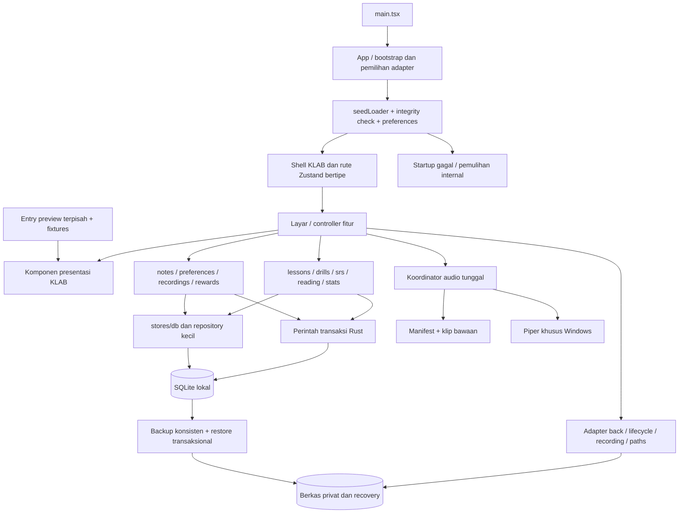

# Arsitektur frontend Lernen / KLAB

Tanggal: 17 November 2026, Asia/Jakarta. Status: **arsitektur tujuan; infrastruktur frontend terisolasi sudah disiapkan, belum dipasang ke aplikasi awal**. Pemilik keputusan rutin: penyusun arsitektur. Detail kebijakan baru tetap usulan, bukan persetujuan produk tambahan.

Instruksi pengguna terakhir berkembang menjadi: siapkan infrastruktur frontend sekarang, backend tetap agent1–2–3 OpenCode; aplikasi awal diselesaikan sebelum perpindahan. Implementasi awal hanya namespace `src/klab/`, entry/config preview terpisah dan tesnya, tanpa mengaktifkan migrasi UI produksi, port Android, perubahan skema atau build APK. [README infrastruktur](../../src/klab/README.md) menjelaskan yang tersedia, [handoff backend](lernen-klab-backend-handoff.md) menjelaskan batas layanan. PRD §0.7 dan handoff tetap mengatur penyelesaian Windows. Android adalah prioritas penggunaan untuk arsitektur tujuan, sesudah gate kesiapan Windows pada [rencana migrasi](lernen-klab-frontend-migration-plan.md#gate-0--aplikasi-awal-siap). Tidak ada tanggal perpindahan otomatis.

Rujukan: [prompt tugas](../prompts/PROMPT-GPT-6.1-SOL-ARSITEKTUR-FRONTEND.md), [PRD §0](../../PRD-Aplikasi-Belajar-Bahasa-Jerman.md), [handoff](../../HANDOFF-LERNEN.md), [spesifikasi KLAB](../superpowers/specs/2026-11-17-lernen-klab-ui-design.md), [peta fitur/aset](lernen-klab-feature-asset-map.md). [Snapshot sumber](evidence-2026-11-17/source-snapshot.json) mencatat hash, ukuran dan status Git; HEAD saja tidak mewakili workspace yang banyak perubahan belum di-commit.

## 1. Keputusan inti dan fakta pembatas

**Ketentuan pengguna setelah persiapan frontend:** seluruh konten aplikasi lama wajib ada di aplikasi baru sebagai standar capaian yang mengacu PRD. Baseline minimum dibekukan pada [CONTENT-PARITY-20261117-01](evidence-2026-11-17/legacy-content-baseline.json). Integrasi harus membuktikan identitas, isi/relasi, penilaian, akses rute dan audio yang tersedia, bukan jumlah saja; fixture bukan konten hasil migrasi. Konten tambahan/edit/hapusan/progres pengguna tetap dijaga. Koreksi sah dicatat sebagai delta, tidak mengubah baseline untuk menutupi kehilangan. [Penugasan Agent1–2–3](../superpowers/plans/2026-11-17-lernen-backend-agent123-followup.md) memuat gate dan pemilik pembuktiannya.

Pertahankan React + TypeScript + Vite + Tailwind + Zustand + Tauri/SQLite. KLAB adalah arah visual **Lernen**, bukan penggantian nama aplikasi. Migrasi vertikal menjaga domain belajar, identitas data, FSRS, seed dan transaksi Rust; tidak membuat aplikasi kedua atau backend daring.

Versi resolved pada lockfile yang diperiksa: React/DOM 19.3.1, TS 6.0.3, Vite 8.3.6, Tailwind 4.3.5, Zustand 5.1.0, ts-fsrs 5.4.2, Tauri API/CLI 2.12.4, plugin SQL 2.6.0, opener 2.7.2. Cargo.lock: Tauri 2.12.5, SQL 2.6.0, opener 2.7.2. Rentang package.json bukan versi resolved. Tidak menambah dependensi dalam tahap dokumen ini.

Fakta sumber sekarang:

- Sembilan halaman terdaftar di `src/ui/pages/index.ts`, semuanya dipetakan pada empat tujuan baru. Latihan Hören/Schreiben, percakapan bercabang dan Uji A1 sudah ada, bukan backlog fitur kosong.
- `stores/nav.ts` hanya `page: string` dan `pendingDrill`; `Kurikulum` menyimpan `View` lokal. App mengganti komponen halaman sehingga state lokal layar yang dilepas dapat hilang. Rail `w-60`, padding `px-10`, CSS light-only/serif/emas belum mengikuti KLAB.
- SQLite migrasi v3 sudah menambah `lesson_drafts`, session/objective ID pada attempts dan indeks unik sesi/item. `save_attempt_with_draft` serta `save_checkpoint_result` sudah transaksional. Jangan mengimplementasikannya ulang hanya karena spesifikasi lama §11 menyebut localStorage saja.
- Jaminan tersebut **berdasarkan jalur pemanggilan**, bukan seluruh aplikasi. `LessonRunner` memberi draftKey ke MiniDrill; CheckpointRunner memberi sessionId tetapi tidak draftKey, menyimpan jawaban hasil pada ref memori; remedial belum memberi kedua identitas itu. Drill utama menyimpan attempt namun state store belum persisten. SRS state+attempt atomik, antrean sesi belum dipersistenkan. Latihan writing masih localStorage, listening/percakapan memori. Uji A1 hanya hasil terakhir di config, timer/jawaban sesi memori.
- `LessonRunner` masih menulis mirror localStorage dan pemanggilan `saveDraft` tambahan setelah transaksi. Ini bukan satu sumber kebenaran yang ideal; perlu serialisasi/revisi dan pengujian urutan tulis saat migrasi. Hasil checkpoint terakhir/best/ever-passed sudah ada; bukan ledger lengkap atau hitungan lulus.
- Audio sumber 455 WAV / 35,05 MiB; 454 WAV root tercakup glob URL. Jumlah, manifest dan emisi historis di peta aset. Decode hanya saat klip dipakai; eager URL import tidak memuat semua PCM ke RAM.
- Windows `minWidth:900`, `minHeight:600` membatasi uji jendela sempit. `src-tauri/gen` yang ditemukan hanya schemas, bukan proyek Android. Target Rust terpasang yang teramati hanya x86_64-pc-windows-msvc; adb/java tidak ditemukan pada PATH. Ini tidak membuktikan Android SDK tidak ada di disk, tetapi belum ada bukti toolchain siap.

Tidak membangun knowledge graph baru: `graphify-out/graph.json` tidak ditemukan; pemetaan terbatas ini ditelusuri melalui import, pemanggil, SQL dan file pemilik aktual. Tidak ada klaim AST graph/cycle analysis yang belum dijalankan.

## 2. Batas modul dan aliran data



Aturan dependensi:

1. Presentasi menerima data, state simpan, callback; tidak SQL, invoke, grading, FSRS atau pemilihan bank. Controller fitur memanggil domain miliknya, bukan state internal layar lain.
2. `lessons/*`, `drills/*`, `srs/*`, `reading/*`, `stats/*` tetap pemilik aturan. `gradeCheckpoint`, `evaluateObjectiveResult`, `feedbackFor`, `optionOrder`, `buildDrillSession`, `nextCard`, `syncSeedWords` dipakai ulang. Hapus salinan aturan hanya setelah parity test; jangan memindahkan logika ke komponen tema.
3. `stores/db.ts` tetap koneksi singleton SQL produksi; Rust memakai pool plugin yang sama. Pindahkan query dari halaman hanya ketika irisan terkait disentuh. Tidak membuat ORM/repository generik untuk semua tabel.
4. `platform/*` berisi perbedaan nyata OS; tidak membawa navigasi atau pedagogi. Native invoke hanya dari adapter/domain transaksi, bukan tombol dekoratif.
5. Cache query adalah turunan; setelah commit, invalidasi agenda/statistik/daftar terkait. Gagal refresh tidak memicu replay attempt/review. Tidak ada event bus global atau sinkronisasi jaringan.

### Struktur target bertahap

`[baru]` dibuat saat task membutuhkan; `[tetap]` tidak dipindah sekaligus. Nama berikut adalah tujuan implementasi, bukan semua direktori yang sudah tersedia. Infrastruktur saat ini berada di `src/klab/` agar file pemilik agent lain tidak disentuh; pemindahan ke struktur akhir hanya setelah integrasi.

```text
src/
  main.tsx, App.tsx, App.css                 [tetap; App menjadi composition root]
  app/                                     [baru]
    bootstrap.ts                           urutan init dan error readiness
    routes.ts, RouteView.tsx                union rute dan render/lazy screens
    sessionRegistry.ts                     resolve sesi aktif dari SQLite
  stores/
    nav.ts                                 [perluas; compatibility setPage sementara]
    db.ts, backup.ts                       [tetap; perluasan backup saat skema baru]
  ui/
    Layout.tsx, PageShell.tsx               [ubah bertahap menjadi shell/header KLAB]
    FatalDatabase.tsx                      [tetap; tampilan/adapter pemulihan]
    pages/*                                [tetap selama migrasi masing-masing]
    lessons/*, review/ReviewCard.tsx         [tetap; ekstraksi controller ketika disentuh]
    shell/BottomNav.tsx, NavRail.tsx         [baru]
    components/                            [baru; hanya komponen yang dipakai]
      Button.tsx, Field.tsx, Dialog.tsx, Sheet.tsx
      ComicPanel.tsx, MascotReaction.tsx, SaveStatus.tsx
      LessonReader.tsx, Explanation.tsx, ObjectiveResult.tsx
      AudioControls.tsx, RecordControls.tsx
    tokens.css                             [baru; light/dark semantik]
  features/                                [baru]
    explore/ExplorePage.tsx                 hub rute materi/kata/bacaan/latihan
    today/agenda.ts                         ekstrak planLesson/planDrill/loadAgenda
    notes/NotesPage.tsx, repository.ts, anchors.ts
    preferences/repository.ts, usePreferences.ts
    practice/ListeningPanel.tsx, WritingPanel.tsx, ConversationPanel.tsx
    practice/session.ts                     ekstrak state dari Latihan saat parity
    exam/session.ts, results.ts             ekstrak UjiTiruan; bukan ganti penilaian
    recordings/repository.ts               metadata + kompensasi file
    rewards/queries.ts                      baca ledger, bukan pemberi hadiah UI
  lessons/
    units.ts, objectives.ts, practice.ts, feedback.ts, answerMatch.ts,
    optionOrder.ts, checkpointResult.ts, checkpointStore.ts,
    drillDraft.ts, persistence.ts           [tetap; perluas kontrak di bawah]
    sessions.ts, rounds.ts, access.ts       [baru; reuse transaksi dan policy]
  drills/*, srs/*, reading/*, stats/*        [tetap; refactor per irisan]
  audio/coordinator.ts, bundle.ts          [baru; ekstrak dari srs/tts saat audio task]
  srs/tts.ts                               [fasad kompatibilitas speak selama transisi]
  platform/contracts.ts, windows.ts, android.ts
  data/*                                  [tetap; ID blok/manifest tambahan bertahap]
  assets/tts_core/*                        [tetap sampai optimasi tervalidasi]
  assets/klab/*, assets/fonts/*             [baru; aset produksi berlisensi]
preview/index.html, main.tsx, fixtures.ts   [baru; tidak masuk entry produksi]
src-tauri/src/lib.rs                       [tetap; transaksi baru bertahap]
```

Pemetaan file lama → tanggung jawab target yang lebih rinci ada pada peta fitur; tidak ada alasan memindah semua folder domain ke `features` atau mengganti ekstensi nama hanya untuk estetika.

## 3. Navigasi dan pemulihan konteks

**Keputusan:** perluas Zustand, tanpa library router baru. Sembilan layar lokal, nested view sederhana dan tanpa kebutuhan URL publik/SSR dapat ditangani union kecil. Biaya utama adalah history dan persistence yang tetap perlu dibangun walau memakai router. Tinjau ulang jika kemudian ada banyak URL eksternal/deep-link OS; sekarang cukup tautan internal tervalidasi.

Kontrak target `app/routes.ts`:

```ts
import type { LevelCode } from '../lessons/units';
import type { DrillCode } from '../drills/items';
type Tab = 'today' | 'explore' | 'notes' | 'profile';
type Route =
  | { name: 'today' }
  | { name: 'explore'; section: 'materials'|'vocabulary'|'reading'|'practice'; level?: LevelCode }
  | { name: 'unit'; unitNo: number }
  | { name: 'lesson'; unitNo: number; lessonNo: number; sessionId: string }
  | { name: 'checkpoint'; unitNo: number; sessionId: string }
  | { name: 'drills'; code?: DrillCode }
  | { name: 'srs'; sessionId: string }
  | { name: 'reader'; textId: number }
  | { name: 'practice'; kind: 'listening'|'writing'|'conversation'; contentId: string; sessionId: string }
  | { name: 'exam'; sessionId?: string }
  | { name: 'notes'; noteId?: string }
  | { name: 'profile'; section: 'overview'|'stats'|'settings'|'recordings'|'recovery'|'legacy-tools' };
interface Navigation {
  push(route: Route): void;
  replace(route: Route): void;
  selectTab(tab: Tab): void;
  back(): void;
}
```

Setiap tab punya stack maksimal 20 entry, `selectTab` memulihkan stack terakhir tanpa menumpuk duplikat. Session route menyimpan ID saja; data soal/jawaban bukan parameter navigasi. `setPage` lama sementara dipetakan: hari-ini→today, kurikulum→materials, drill→drills, kosakata→vocabulary, membaca→reading, latihan→practice, uji-a1→exam, statistik→profile/stats, pengaturan→profile/settings. `startDrill` menjadi push drills(code); hilangkan pending state setelah semua pemanggil dialihkan.

Sesi mengisi viewport HP; bottom nav tidak menutupi input/aksi. Kembali dari sesi menangguhkan, bukan menghapus. Pada desktop rail boleh tetap tampak sesuai mockup. Back menangani berurutan: tutup dialog/panel transient → flush editor bila perlu → pop nested view → tab Hari Ini → perilaku root Android. Bila simpan gagal, kembali ditahan dengan pilihan Coba lagi atau Tetap di sini; bila pengguna sengaja meninggalkan draft belum tersimpan, jelaskan kehilangan perubahan yang belum dikomit. Jangan mengklaim teks memori aman setelah proses dibunuh.

Android: adapter memakai `onBackButtonPress` yang tersedia pada API 2.12.4 lokal. Listener mengambil alih default; root tanpa draft/rekaman pending melepas listener lalu memanggil back native melalui bridge Android minimal sehingga kembali ke OS secara normal, bukan pop halaman palsu atau `exit(0)` paksa. Detail bridge dan predictive-back harus dibuktikan pada spike perangkat. Desktop Alt+Left dan tombol Kembali memakai aksi yang sama; Escape menutup dialog dengan focus return, tidak memeriksa jawaban. Browser preview memetakan history/popstate pada adapter preview saja, tidak menjalankan dua history pemilik bersamaan di Tauri.

Deep-link internal berbentuk objek Route, bukan parsing string bebas. Validasi ID unit/lesson/text/session saat resolve; data hilang menampilkan sumber berubah/tidak tersedia + kembali ke daftar. Tidak menambah OS URL scheme sekarang. Posisi baca disimpan sebagai blockId/sentence anchor + offset relatif, bukan hanya pixel; scroll dipulihkan sesudah konten/font siap. `reader:textId`/`lesson:unit:lesson` adalah kunci posisi, bukan judul yang bisa berubah.

Persist `config.ui_navigation_v1` hanya rute terakhir yang tervalidasi dan stack root pendek; session registry menjadi sumber sesi. Urutan startup: migrasi SQL → seed aman/integrity → load preferensi dan sesi → resolve rute → render. Jangan persist `loading/submitting` sebagai aksi yang harus diulang otomatis. Reload mencari receipt/revisi terakhir sebelum menawarkan retry.

## 4. Pemilik state dan waktu tulis

| State | Sumber kebenaran | Tulis dan kegagalan |
|---|---|---|
| Dialog, hover, pilihan teks, panel penjelasan | useState pada komponen | Lokal; tidak menulis progres. Simpan posisi sebelum panel fullscreen |
| Rute, stack, filter daftar, fokus kembali | Zustand nav; last-route di config | Push/tab setelah rute valid; flush last-route terurut, kegagalan tidak memblokir belajar |
| Preferensi UI/onboarding | config `ui_preferences_v1`; store hanya salinan | Serialisasi patch, tampil segera tetapi status Tersimpan sesudah commit; retry patch sama |
| daily_new/max, srs_new_level, tts_rate, piper_* dan goal | key config yang sudah ada | Jangan duplikasi ke preferensi UI; pakai fungsi domain/config pemilik |
| Konten seed, entries/texts edit pengguna | JSON sumber + SQLite hasil seed/ubah pengguna | `seedLoader` tetap pemilik sync; UI tidak menulis ulang seed saat tema berubah |
| lesson_progress, FSRS, attempts | SQLite + transaksi Rust yang ada | Commit sebelum maju soal/grade; agregat statistik boleh diperbarui kemudian |
| Sesi aktif, soal/order/jawaban/hasil/draft | Envelope SQLite ber-versi di `lesson_drafts` | Init sebelum soal pertama; tiap jawaban+draft atomik, next/posisi diserialkan; bukan save effect bersaing |
| Isi catatan/sorotan | tabel notes baru; editor buffer lokal | Debounce 400 ms dan flush saat blur/navigasi; per-note writer terurut, konflik revisi tidak menimpa diam-diam |
| Posisi baca | config `read_position:<sourceKey>` | Debounce 400 ms, flush saat pindah; tidak mempengaruhi nilai |
| Putaran, hasil immutable, hadiah | SQLite tabel baru | Satu transaksi finalisasi; query jumlah, jangan `count++` pada UI |
| Rekaman | berkas privat + metadata SQLite | Protokol staged/finalized; DB tidak bisa menjamin atomicity dengan filesystem sendiri |
| Audio aktif/cache | koordinator audio proses tunggal | Resource ephemeral, tidak backup PCM; stop/release pada suspend/dispose |

Debounce tidak memberi jaminan menyelamatkan setiap ketikan saat kill mendadak. Indikator dirty/saving/failed harus jujur; hasil yang sudah diakui tersimpan wajib bertahan restart. State React tetap sama saat resize: satu pohon runner dengan layout CSS; jangan render dua runner HP/desktop lalu menyembunyikan salah satu.

## 5. Kontrak kecil antarmodul

Semua nama di bagian ini adalah **kontrak yang diusulkan**, kecuali fungsi existing yang disebut eksplisit. Implementasi memvalidasi JSON pada batas baca; cast TypeScript saja bukan validator. Reuse tipe `DrillItem`, `CheckpointGrade`, `ObjectivePolicy`, `GradeKey`; tidak membuat grader kedua. Error native string saat ini dipetakan adapter, sambil menjaga detail diagnostik lokal.

```ts
type Failure = {
  code: 'not-ready'|'invalid'|'not-found'|'conflict'|'storage-full'|
        'save-failed'|'unsupported'|'permission-denied'|'audio-missing'|'interrupted';
  message: string;
  retryable: boolean;
};
type Result<T> = { ok: true; value: T } | { ok: false; error: Failure };
type SaveState = 'clean'|'dirty'|'saving'|'saved'|'failed';
type Preferences = {
  version: 1; theme: 'system'|'light'|'dark'; learningMode: 'ordered'|'free';
  textScale: 1|1.125|1.25; reducedMotion: 'system'|'on';
  reactions: boolean; reactionSound: boolean; reactionVolume: number;
  quietMode: boolean; onboardingCompleted: boolean;
};
interface PreferencesRepository {
  load(): Promise<Result<Preferences>>;
  patch(change: Partial<Omit<Preferences,'version'>>): Promise<Result<Preferences>>;
}
```

Default keputusan arsitektur: system, ordered, skala 1, motion system, reaksi visual aktif, suara reaksi mati, volume 0.3, quietMode mati. Satu record config; patch tervalidasi/terurut agar dua kontrol tidak saling menghapus. Konfigurasi rusak tetap disimpan untuk diagnosis, gunakan default + pemberitahuan, tidak reset progres. Reduced motion efektif = OS meminta **atau** pengguna memilih on. Kontrol ukuran aplikasi bukan pembatas zoom OS/browser 200%.

### Catatan dan anchor

```ts
type SourceRef =
  | { kind: 'lesson'; unitNo: number; lessonNo: number; blockId: string }
  | { kind: 'reading'; textId: number; blockId: string };
type Anchor = {
  source: SourceRef; contentVersion: string;
  quote: string; prefix: string; suffix: string;
  start: number; end: number; // Unicode code point offsets dalam blok
};
type Note = {
  id: string; revision: number; title: string; body: string;
  anchor: Anchor|null; color: 'yellow'|'blue'|'red'|null; updatedAt: string;
};
interface NotesRepository {
  list(source?: SourceRef): Promise<Result<Note[]>>;
  save(note: Note, expectedRevision: number): Promise<Result<Note>>;
  remove(id: string, expectedRevision: number): Promise<Result<void>>;
}
```

ID unit global existing dipertahankan (A1 1–12, A2 101–110, B1 201–210, B2 301–310). Slide sekarang title/body arrays tanpa block ID; `Sentence.id` sekarang teks terjemahan Indonesia, **bukan identitas kalimat**. Tambah `blockId` terpisah dan sidecar mapping versi awal untuk lesson slide/body dan teks seed. ID eksplisit tetap saat paragraf diedit/disisip, bukan hash isi/index baru setiap release. Teks pengguna diberi ID saat ditulis/dimigrasikan; seed key lama tetap dipakai untuk matching update agar perubahan anchor tidak membangkitkan item terhapus.

Anchor resolver: source+block ID → cocokkan quote pada rentang → cari exact quote unik dengan konteks → tandai orphan. Jangan menempelkan catatan ke bagian yang ambigu; simpan quote/body dan label **Bagian sumber berubah**. Hapus kata/bacaan tidak cascade-delete catatan. HP editor fullscreen, tablet panel, desktop daftar+editor+pratinjau. Awal cukup judul/body teks dengan line breaks dan sorotan; toolbar bold/list mockup dapat ditambah sebagai format terbatas setelah sanitizer/aksesibilitas, tidak perlu editor web besar. Teks Jerman dalam komik tetap DOM yang bisa dibaca/dipilih; balon bukan paragraf raster saja.

### Sesi, hasil, putaran dan hadiah

```ts
import type { DrillItem } from '../drills/items';
import type { CheckpointGrade } from '../lessons/checkpointResult';
type SessionKind = 'lesson'|'checkpoint'|'remedial'|'drill'|'srs'|
                   'listening'|'writing'|'conversation'|'exam';
type SessionHead = {
  version: 1; id: string; kind: SessionKind; revision: number;
  contentKey: string; contentVersion: string; roundId: string|null;
  status: 'active'|'paused'|'completed';
};
type QuizSession = SessionHead & {
  kind: 'checkpoint'|'remedial'|'drill'; items: DrillItem[];
  index: number; answers: Array<{ itemKey: string; chosen: string; correct: boolean }>;
  optionOrders: Record<string,string[]>; seenKeys: string[];
};
interface QuizSessions {
  load(id: string): Promise<Result<QuizSession>>;
  create(session: QuizSession): Promise<Result<QuizSession>>;
  answer(id: string, expectedRevision: number, itemKey: string,
         chosen: string): Promise<Result<QuizSession>>;
  advance(id: string, expectedRevision: number): Promise<Result<QuizSession>>;
  pause(id: string, expectedRevision: number): Promise<Result<QuizSession>>;
}
type CompletionReceipt = {
  sessionId: string; roundId: string|null; stored: true;
  passed: boolean; firstPassInRound: boolean; countedPasses: number;
  legacyEverPassed: boolean; awardedXp: number;
};
interface UnitRounds {
  begin(unitNo: number, operationId: string): Promise<Result<{roundId:string}>>;
  complete(sessionId: string, grade: CheckpointGrade,
           operationId: string): Promise<Result<CompletionReceipt>>;
}
```

Controllers `QuizSessions` memanggil matcher/feedback/policy existing. `answer` tidak menerima boolean benar dari tombol; controller menentukan via domain, kemudian repository Rust menyimpan tervalidasi. Bentuk envelope lesson/SRS/practice/exam dibuat spesifik di task domain, tidak satu `unknown` tanpa schema. Minimum lesson: step, block/slide, drillScore; SRS: card IDs+visit IDs/index/grades; listening: dialogue ID/answers/optionOrders/audioFailed; writing: task ID/body/checks; conversation: scenario/node IDs/path pilihan; exam: section/answers/rubrik/draft/order/audio failures/deadline per bagian. Deadline UTC disimpan saat mulai bagian; background tidak me-reset waktu. Uji adalah latihan tanpa pengawasan; perubahan jam perangkat tidak boleh dipasarkan sebagai anti-cheat.

Snapshot soal dan urutan pilihan dikunci ketika sesi dibuat; resume tidak mengambil sampel bank ulang. Jawaban terdahulu tidak ditulis ulang saat mencoba soal baru. Gunakan revisi compare-and-set untuk stale writer dan operationId unik untuk retry commit. `save_attempt_with_draft` tetap basis transaksi, diperluas secara kompatibel untuk revision/receipt; UI tidak menjalankan dua SQL terpisah. Existing unique `(session_id,item_key)` berlaku soal yang dinilai sekali; SRS `again` memiliki **visitId** baru karena kartu boleh dinilai ulang sah, bukan dedupe seluruh kartu dalam satu sesi.

Checkpoint/remedial: hasil per tujuan memakai policy unit, kasus 11/15 dengan [3,3,2,2,1] tetap gagal; remedial tidak mengubah grade checkpoint. Simpan gagal mempertahankan result+operationId dan tombol retry. Current `saveCheckpointResult` tetap fasad snapshot; finalisasi baru menulis ledger dan snapshot bersama. Riwayat lawas hanya best/ever-passed tidak diubah menjadi jumlah pasti.

Rancangan tabel tambahan, migrasi append-only sesudah v3 (nomor aktual ditentukan ulang saat mulai karena proyek aktif):

| Tabel/record | Kunci dan invariant | Pemilik |
|---|---|---|
| `lesson_drafts` diperluas | envelope version + revision; satu writer per session | lessons/sessions + Rust |
| `notes` | id PK, revision; anchor JSON tervalidasi; tanpa cascade sumber | notes/repository |
| `unit_rounds` | round_id PK, unit_no, ordinal, status; hanya satu putaran aktif per unit | lessons/rounds + Rust |
| `unit_passes` | round_id UNIQUE, checkpoint_session_id; satu lulus sah per putaran | transaksi finalisasi |
| `checkpoint_results` | session_id PK; grade/policy/content version immutable | transaksi finalisasi |
| `reward_events` | event_key UNIQUE, points, local_day, policy_version | transaksi domain saat event sah |
| `recordings` | id PK, relative_path UNIQUE, bytes, duration, mime, state | recordings + platform storage |
| config `unit_access_v1` atau tabel akses | akses lama dan pernah lulus monotonik; putaran ulang tidak mengunci unit | lessons/access |

Mulai putaran hanya jika ever_passed benar; operasi begin retry mengembalikan round ID sama. Jangan mengosongkan `lesson_progress` untuk mengulang. Progres putaran diturunkan dari sesi/hasil ber-roundId; lesson_progress lama tetap ringkasan kompatibilitas. Pertahankan akses unit lama dari state done, snapshot ever_passed dan rantai unlock. Free mode membuka materi tanpa memberikan kelulusan/XP; kembali ordered tidak menutup unit yang sudah terbuka sah. SRS jadwal/due tidak di-reset dan free mode tidak otomatis mengubah `srs_new_level` atau memasukkan semua kartu lanjutan.

XP: event kecil, tanpa mesin gamifikasi. Usulan +20 pelajaran/round, +30 pass/round, +10 sesi SRS 10 kartu/hari lokal; policy v1 disimpan, bukan hardcode di komponen. Event keys misalnya `lesson:<round>:<lesson>`, `pass:<round>`, `srs-day:<localDate>`. Untuk SRS, hitung 10 kartu unik yang benar-benar mendapat review committed, bukan 10 reveal atau 10 kunjungan kartu sama. Lencana query event sah; catatan pertama tidak menghasilkan hadiah baru setelah delete/recreate. Angka kebijakan masih usulan. Tidak retroaktif membuat XP, count pass atau label Mahir A1 dari histori yang tidak ada.

### Audio dan rekaman

```ts
type AudioRequest =
  | { text: string; role: 'lesson'|'reaction'; rate?: number }
  | { recordingId: string; role: 'recording' };
interface AudioService {
  capability(text: string): 'bundle'|'piper'|'missing';
  play(request: AudioRequest): Promise<Result<{source:'bundle'|'piper'|'recording'}>>;
  stop(): void;
  release(): Promise<void>;
}
type RecordingState = 'idle'|'requesting'|'recording'|'preview'|'saving'|'saved'|'error';
type RecordingPreview = { id: string; mime: string; durationMs: number; bytes: number };
interface Recorder {
  start(): Promise<Result<void>>;
  stop(): Promise<Result<RecordingPreview>>;
  save(id: string, source: SourceRef|null): Promise<Result<{id:string}>>;
  discard(id: string): Promise<Result<void>>;
  dispose(): Promise<void>;
}
```

`AudioService.play` memakai discriminated union `text` vs `recordingId` agar salah panggil ditolak dan tidak menjalankan TTS atas ID. `srs/tts.ts` tetap fasad bagi semua pemanggil existing selama ekstraksi; jangan ubah fungsi `speak` secara massal sebelum parity audio.

Satu arbiter: satu suara aktif; contoh/rekaman menghentikan efek, efek tidak memotong ujaran, start rekam stop semua playback. Generation/cancellation token membuang hasil Piper async yang datang setelah stop. Loop dialog berhenti saat route keluar/background; promise `play` selesai ketika audio berakhir/dibatalkan, termasuk segmented numbers yang sekarang return segera setelah start. Suara reaksi default off dan volume terpisah, tidak bergantung pilihan volume ucapan.

Recorder usulan maksimum 60 detik, tampil timer/Hentikan/Batal, tidak otomatis meminta izin saat startup. Ditolak/unsupported → Lanjut tanpa rekam, tetap materi/audio; bukan nilai gagal. Tidak ASR, upload atau penilaian CEFR/pelafalan. Sumber lama percakapan dipakai ulang, bukan LLM.

Simpan file melalui temporary ID → finalize rename pada direktori privat → metadata committed. Catat staged metadata/jurnal agar restart dapat menuntaskan atau mengidentifikasi orphan. Gagal metadata: preview/file tetap ditahan untuk retry, tidak ada label tersimpan; scanner startup membersihkan hanya temporary yatim milik aplikasi dengan kebijakan umur, tidak rekaman valid. Delete banyak: konfirmasi jumlah, tandai pending-delete, hapus file lalu metadata/tombstone dengan retry; tidak menyentuh note/progres. Batas resource tidak hanya durasi: preview maksimal 8 MiB, hentikan aman saat cap, validasi klip kosong dan MIME asli. Rekaman pengguna dihitung terpisah dari ukuran aplikasi.

## 6. Platform dan lifecycle

| Variasi | Windows | Android tujuan | Batas verifikasi |
|---|---|---|---|
| Audio terkurasi | Web Audio + bundle existing | bundle yang sama sebagai default | Codec/asset URL/CSP perlu uji perangkat |
| Teks bebas | Piper optional, engine/model terpisah | status missing + teks/transkrip; tidak mengunduh model besar | Jangan menjalankan piper.exe |
| Mikrofon | adapter WebView2 MediaRecorder bila terbukti | adapter rekam native Android minimal, atau WebView jika spike membuktikan izin/codec/lifecycle | Belum ada implementasi keduanya |
| Path/backup | Rust path dan folder pilihan existing | app-private files, pemulihan dalam app | Tidak memasukkan path Windows ke UX Android |
| Buka folder | explorer existing | tidak tersedia; tampil kelola/pulihkan internal | Jangan panggil command Windows di mobile |
| Back/lifecycle | nav action + window events | hardware/gesture back + foreground/background native bridge | App kill bukan event yang selalu bisa di-flush |
| Safe areas/keyboard | CSS viewport/window | env inset + native inset bila CSS tidak tersedia, keyboard resize | Dibuktikan cutout/gesture/IME perangkat |

Rust sekarang `piper_install_engine` mengunduh ZIP Windows amd64, `PiperProc` memanggil piper.exe, `backup_open_folder` explorer, sementara hanya creation flag yang di-`cfg(windows)`. Guard seluruh implementasi/registrasi Windows dan target-dependency ureq/zip/base64 bila hanya diperlukan desktop; berikan capability result unsupported di Android. Tidak menyalin service Windows ke adapter Android. Deskripsi Cargo personal dan identifier desktop tidak otomatis menjadi konfigurasi Android. Pertahankan identifier Windows untuk data lama; ID Android dan flavor QA ditetapkan saat port, tidak mengubah produksi sekarang.

Dokumentasi resmi yang diperiksa 17 November 2026: [SQL plugin](https://v2.tauri.app/plugin/sql/) mencantumkan Android; ini dukungan plugin, bukan sertifikat aplikasi ini. [Prasyarat Tauri Android](https://v2.tauri.app/start/prerequisites/#android) memerlukan Android Studio/SDK/NDK dan target Rust; belum dipasang/dibangun pada tugas ini. [API back](https://v2.tauri.app/reference/javascript/api/namespaceapp/#onbackbuttonpress) menjelaskan listener mengambil alih default. API tersebut juga ditemukan dalam package lokal; native bridge tetap perlu bukti.

Izin rekam memerlukan alur runtime dan penolakan yang tepat menurut [Android permissions](https://developer.android.com/training/permissions/requesting). WebView juga mempunyai [onPermissionRequest](https://developer.android.com/reference/android/webkit/WebChromeClient#onPermissionRequest(android.webkit.PermissionRequest)); tidak menganggap `getUserMedia` cukup tanpa host grants. [MediaRecorder.isTypeSupported](https://developer.mozilla.org/en-US/docs/Web/API/MediaRecorder/isTypeSupported_static) hanya pemeriksaan awal MIME, bukan jaminan perekaman tidak gagal. Pilihan native/WebView diputuskan setelah spike yang terukur, bukan instal plugin spekulatif.

Suspend: stop playback dan rekam, stop tracks, pause AudioContext, flush writer yang sedang hidup, hentikan study clock; resume cek clock/deadline, muat committed revision, tawarkan pratinjau rekaman terinterupsi. Tidak meminta izin ulang otomatis dan tidak memutar suara otomatis. SQLite commit per jawaban adalah perlindungan utama; shutdown handler bukan pengganti transaksi.

## 7. Sistem UI dan fidelitas visual

**Fidelitas terhadap empat JPG adalah kriteria penerimaan, bukan inspirasi opsional.** File terinspeksi dan hash ada di peta aset. Gunakan 02-KLAB untuk bahasa visual, tiga detail untuk nama Lernen dan kebutuhan layar terkini. Angka mockup adalah fixture, bukan nilai produksi. Smartphone bezel, judul papan presentasi dan window chrome ilustratif tidak menjadi elemen app.

Konstanta visual yang harus tampak: wordmark Lernen tebal condong dengan garis sapuan merah/kuning; kucing putih, telinga biru, syal merah dengan pose tenang/semangat/terkejut suportif; panel komik ber-outline tinta; halftone dan garis gerak di tepi; header sapuan kuning; tab/seleksi biru; CTA lanjut/rekam merah; progress segmen buku; ribbon nomor unit. Isi materi tetap dominan dan terbaca, bukan grid KPI dashboard generik. Panel feedback dan hasil tidak memakai pose mengejek kesalahan.

Komposisi yang diikat: HP Hari Ini header+mascot → kartu lanjut → remedial/SRS → buku/progres → motivasi ringan → empat tab. Materi HP judul/ribbon → panel komik → teks ajar/contoh audio → penjelasan/catatan → CTA. Tablet baca+catatan; desktop Catatan daftar+editor+pratinjau. Gelap tetap panel ber-outline/komik dan aksen tiga warna, bukan light theme di-invert mentah. Aset kucing/panel asli harus diproduksi terpisah; screenshot JPG bukan UI.

Token semantik awal, diambil dari spec dan harus diuji pada pasangan aktual:

| Token | Light | Dark |
|---|---|---|
| canvas / surface | #FFFCF5 / #FFFFFF | #151922 / #222938 |
| text / muted | #172033 / #475569 | #F5F7FB / #BAC5D6 |
| primary / on-primary | #1746D1 / #FFFFFF | #99B6FF / #101827 |
| action / on-action | #B83226 / #FFFFFF | #FFADA2 / #241411 |
| highlight / on-highlight | #FFE16A / #172033 | #E8CA58 / #171A21 |
| border / focus | #667085 / #1746D1 | #8B99AF / #FFE16A |

CTA terang mockup boleh punya aksen merah lebih cerah pada ornamen, namun teks tombol memakai pasangan berkontras; jangan meratakan seluruh CTA menjadi pastel tanpa comparison. Tambah semantic success/danger/surface-muted melalui pasangan tervalidasi, bukan hardcode kelas warna per halaman. Alias token parchment/gold/ink lama sementara menunjuk token semantik agar layar lama tidak rusak; hapus alias sesudah semua konsumen dialihkan. `color-scheme` mengikuti tema efektif di root.

Tipografi: satu keluarga sans lokal berlisensi jelas, minimal body regular + heading bold/extra-bold; wordmark vektor kustom. Belum ada font lokal produksi. Pilih font sesudah bukti file/OFL dan cek glyph ä ö ü ß, tanda baca, angka; tidak hotlink Google Fonts. Body default 16–18 px, line-height 1.5–1.65, lebar baca 62–70ch; heading 24–36 sesuai ruang, bukan semua serif existing. Skala teks aplikasi dan zoom 200% harus reflow, tidak clipping.

Spasi 4/8/12/16/24/32 px; panel radius 12, outline 1.5–2 px, shadow pendek seperti tinta. Area sentuh min 48×48 logical px dan gap 8, termasuk umlaut yang kini h-7/w-7. Fokus ring 3 px+offset 2, kontras teks normal ≥4.5:1 dan kontrol/indikator ≥3:1; ukur state disabled/selected/error juga. Ikon SVG lokal satu gaya, label aksesibel; dekorasi aria-hidden, gambar bermakna punya alt. Status simpan `aria-live=polite`, error actionable `role=alert` tanpa berulang tiap ketikan. Dialog focus trap dan restore; tidak mengandalkan hover/warna/drag.

Responsif: 320–599 satu kolom + bottom nav, 600–1023 rail ringkas bila muat, ≥1024 rail berlabel + konten/panel. Catatan samping hanya saat lebar baca dan panel min 280 px tetap muat; text 200% memaksa satu kolom bila perlu. Padding HP 16, desktop 24–32; `min-width:0` pada flex children, `100dvh` dengan fallback, bottom padding mengimbangi nav+safe area. Target Windows minWidth baru 360/minHeight 600 hanya diterapkan setelah narrow-window task lulus; konfigurasi sekarang tetap 900. Short landscape/IME memakai scroll dan action in-flow, bukan fixed footer menutup textarea.

Reaksi 180–300 ms, non-loop, reduced-motion statis; maksimal satu per kelompok soal; mode tenang menyembunyikan ornamen/komik non-esensial tanpa menghilangkan contoh teks. Suara reaksi default off dan tidak menutupi materi. Detail screenshot matrix, overlay dan gate kelulusan wajib pada rencana migrasi; build lulus tidak menggantikan comparison manusia.

## 8. Aset, ukuran dan pemuatan

Manifest runtime saat ini hanya phrase→filename dan number→offset/duration; manifest produksi baru menambahkan ID, byte/hash, source/license, voice/model version, codec/duration, consumers dan review. Peta aset terukur berisi per-file audit 1.024 baris termasuk data dan dist historis, bukan izin membundel semuanya.

- Lazy route level via React.lazy/Suspense pada RouteView; retry chunk gagal + kembali. Tetap DB/seed bootstrap eager dan idempotent. Pisah data statis per domain setelah extraction UI; seed yang dibutuhkan tetap selesai sebelum readiness, jangan menandai siap pada seed setengah.
- `units.ts` dan `objectives.ts` sekarang eager import semua level/bank; ukuran JSON relatif kecil (~1,11 MiB seluruh JSON), jadi pisahkan per fitur bila hasil ukur cold start menunjukkan manfaat. Jangan async-kan tiap soal hingga offline resume rapuh.
- Bundle audio root 35,02 MiB mengalahkan target desain awal 15–30 MB. Pertahankan WAV baseline sebagai fallback sampai codec listening test lolos pada target. Coba kompresi pada salinan artefak, bukan overwrite sumber. Angka tersegmentasi tetap WAV atau regenerasi offset serta validasi batas sample, semua angka 1–100/jam dan playback rate; encoder delay tidak boleh menggeser potongan.
- Tidak ditemukan duplikat byte di antara 455 WAV sumber. Deduplikasi semantik lewat indeks normalisasi dan canonical phrase IDs, dengan collision test; jangan menggabungkan klip beda lafal hanya karena teks mirip.
- Target cache awal: total decoded buffer LRU ≤24 MiB, termasuk numbers (~10,73 MiB decoded float32), satu klip aktif boleh dipin selama play; batasi decode concurrency 1. Cache base64 Piper desktop ≤8 MiB dan 20 entri (ganti cap 80 count-only), tidak ada Piper cache Android. Budget ini keputusan awal yang harus diprofilkan, bukan RAM hasil ukur.
- Release source nodes/gain connections; revoke object URL saat preview diganti/discard; stop tracks; close/suspend context saat dispose/background sesuai lifecycle; batalkan request stale. Jangan mengunduh aset saat sesi belajar.
- Anggaran produksi visual 5–10 MB dan audio A1 15–30 MB dari spec adalah target awal, bukan ukuran APK. Catat byte/MiB sumber, dist emitted, APK/AAB compressed per ABI, download estimate dan installed data/cache/recordings secara terpisah. Tidak menjanjikan total ukuran sebelum build perangkat.

## 9. Data/recovery dan error ownership

UI tidak dapat menjamin atomicity multi-SQL dengan dua `await execute`. Tiga perintah transaksi existing dipertahankan. Tambahan ledger hasil/putaran/XP harus memperluas transaksi finalisasi Rust; nota penyimpanan tidak dikeluarkan sebelum commit. expectedRevision mencegah effect lama menimpa posisi baru; duplicate operation yang payload-nya beda adalah conflict, bukan success palsu.

Backup existing mengekspor tabel lewat beberapa SELECT berurutan, lalu Rust menulis file temp+fsync+rename; publikasi file atomik **bukan snapshot database konsisten** bila sesi terus menulis. Tambah perintah Rust export snapshot read transaction sebelum skema/sesi baru aktif. Perluas TABLES/optional tables/restore allowlist dan migrasi recovery-to-file bersama. JSON lama diterima dengan notes/rounds kosong; jangan mengosongkan database produksi untuk tes. Backup rekaman harus memiliki manifest file atau label eksplisit metadata-only, tidak berpura-pura audio ikut backup JSON. Android pemulihan memerlukan proses internal aman, bukan instruksi explorer/ganti file manual saja.

| Kondisi | Pemilik | Tindakan lanjut wajib |
|---|---|---|
| Bootstrap/loading | app/bootstrap | tampil proses nyata, tidak render query fitur sebelum DB siap |
| Seed/integrity gagal | bootstrap + FatalDatabase | retry aman, akses backup; data sumber tetap; tidak reset |
| Belum ada progres/catatan/pencarian | halaman terkait | Mulai U1, buat catatan, reset filter; tanpa data contoh palsu |
| Gagal simpan jawaban/hasil/note | repository+controller | input/result tetap, status gagal, retry identitas sama; jangan maju/award |
| Bank tidak cukup | lessons/objectives + checkpoint UI | Checkpoint belum siap, materi/latihan tetap tersedia, tidak fallback mengaku tes tujuan |
| Audio tidak ada/gagal | audio coordinator + layar pemilik | pesan inline, retry/transkrip; D8 tidak menganggap gagal audio sebagai jawaban salah |
| Mikrofon ditolak/unsupported | recorder | lanjut tanpa rekam, instruksi perangkat; belajar/kelulusan tidak diblokir |
| Storage penuh | semua writer + recording manager | pertahankan buffer, kelola rekaman, coba simpan ulang; tidak hapus progres otomatis |
| App background/kill | lifecycle + session repository | stop sumber suara/rekam, pulihkan committed state; periksa receipt sebelum retry |
| Sumber note hilang/seed berubah | notes/anchors | kutipan/body tetap, tandai sumber berubah, opsi buka daftar |
| Backup rusak | recovery | coba kandidat valid berikut, tampil kegagalan; tidak replace file DB aktif |

Recovery dan tool impor/ekspor lama dipindah ke Profil→Pemulihan / Peralatan lama untuk kompatibilitas Windows selama transisi, bukan menu utama KLAB atau syarat onboarding. Pengguna tidak memerlukan UX ekspor/impor baru; tidak menghapus mekanisme/file/data atau akses lama secara diam-diam. Rencana tidak melakukan transfer data Windows→Android otomatis; tanpa akun/cloud, transfer lintas perangkat adalah pekerjaan terpisah bila nanti diminta. ID/format dan recovery dipersiapkan agar data tetap dapat dibaca, bukan janji sinkronisasi.

## 10. Preview/QA dan alternatif yang ditolak

Vite biasa sekarang tidak memiliki API SQL/invoke native; jangan mengira `pnpm dev` adalah aplikasi browser lengkap. Entry `preview/` hanya composition presentasi dengan fixture statis + memory repositories, label Preview/data contoh. Tidak mengimpor App/seedLoader/getDb real, tidak memakai profile produksi, tidak fallback silent dari native gagal ke mock. Pilih adapter saat bootstrap berdasarkan entry/build explicit; fixture tidak dikirim dalam bundle produksi. Preview membuktikan layout/interaksi UI, Tauri QA membuktikan persistence/plugin.

Perubahan tetap dapat dijalankan melalui `app.lernen.qa`; skenario crash/restore pada DB terisolasi. Acceptance wajib mencakup screenshot comparison di HP/tablet/desktop light/dark serta keyboard/zoom/motion, bukan sekadar snapshot yang selalu disetujui ulang. Bukti baru tes dan cakupan ada pada peta dan rencana.

| Alternatif | Keputusan dan alasan |
|---|---|
| Next.js/SSR/backend/cloud | Tolak: aplikasi lokal offline, tidak menyelesaikan masalah sumber sekarang |
| Framework/state/UI kit baru | Tolak: biaya migrasi/data/ukuran tanpa masalah konkret; Tailwind+komponen kecil memadai |
| Router library segera | Tunda: union route + stack kecil cukup; evaluasi ulang bila OS URL kompleks benar-benar diperlukan |
| Rewrite folder/domain sekaligus | Tolak: banyak perubahan aktif; test parity dan rollback lebih sulit |
| Mockup JPG sebagai UI/sprite | Tolak: teks tidak aksesibel/responsif, aset tidak terpisah; produksi aset khusus |
| Semua audio di-decode/preload | Tolak: RAM Android; URL eager ≠ decode, cache harus terukur/berbatas |
| Piper Windows di Android / bundle model besar | Tolak untuk paket awal: platform tidak cocok dan anggaran ukuran |
| Hitung XP/lulus lewat klik/final render | Tolak: retry/crash duplikasi; transaksi beridentitas unik |
| Rekonstruksi jumlah lulus lama dari best score | Tolak: tidak ada bukti jumlah; label riwayat lama |
| Memulai perpindahan sekarang | Tunda sesuai instruksi pengguna: persiapan dokumen dahulu; gate kesiapan aplikasi awal belum terpenuhi |

## 11. Status verifikasi

Baru dijalankan pada sumber snapshot ini: 15 `scripts/test_*.cjs` exit 0; `pnpm exec tsc --noEmit --incremental false` exit 0; `cargo test --locked --offline` exit 0, 8 tes Rust. Output lengkap: [Node](evidence-2026-11-17/node-tests.json), [hasil perintah](evidence-2026-11-17/verification.json). Tes Node sebagian mengeksekusi TS hasil transpile dengan mock, seed menggunakan SQLite :memory:; Rust menggunakan pool/berkas test terisolasi. Tidak membuka profil app.lernen.desktop.

Tahap audit tidak menjalankan build frontend/installer/APK atau UI awal. Sesudah arahan pengguna terakhir, infrastruktur baru diuji tambahan melalui test frontend, typecheck, build preview terpisah dan browser headless; bukti detail di [laporan frontend](../../outputs/frontend-infrastructure-2026-11-17/README.md). Ini tidak mengubah bukti installer/persistence/native/pedagogi aplikasi awal. Dist utama hanya diukur sebagai artefak yang sudah ada. Pemasangan bersih, audio listening manusia, final screenshot fidelity, audit aksesibilitas penuh, Android dan pilot belum diverifikasi oleh pekerjaan ini; aplikasi awal dan perpindahan belum dinyatakan selesai.
